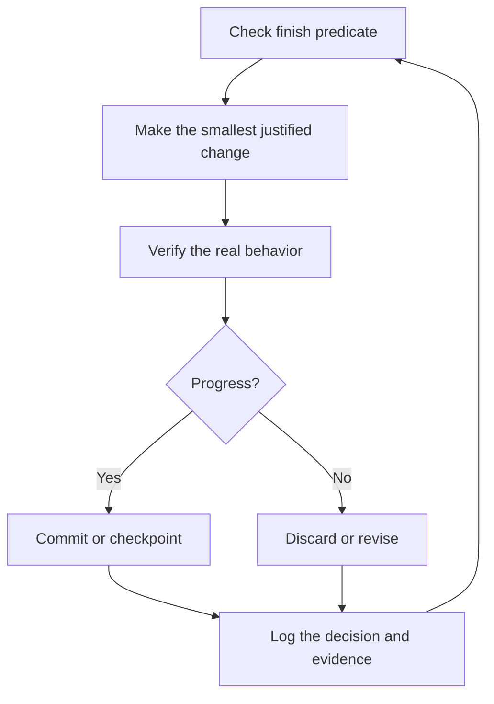

# Run long work safely

Long-running work needs a checkable finish condition, isolated state, and an evidence trail. Persistence does not grant new authority.


## The contract

```text
$poteto-mode migrate every caller to the new parser in a fresh worktree off <base>.
Done means zero old callers, every parser fixture passes, and the old API is deleted.
Keep a decision log. Do not merge or deploy.
Use the available Codex heartbeat or wait mechanism until the predicate passes or a real blocker needs me.
```

The goal states the outcome. The predicate can pass or fail. The worktree prevents concurrent writers from sharing state. The last line grants persistence but still preserves the explicit merge and deploy boundary.

## Runtime choices

- Use a Codex heartbeat automation for periodic rechecks when the host supports it.
- Use a thread wait tool for delegated work.
- Use bounded polling for external checks when no event stream exists.
- Never emulate a scheduler with an unbounded shell sleep loop.
- If the host cannot continue in the background, write a durable checkpoint and stop cleanly.

## The work cycle



## Review the result

Use `$show-me-your-work` to compare the decision trail with the current conversation, diff, commits, and verification output. Review attention items before the full log.

For a queue of independent PRs use Autopilot-full only when merge authority is explicit. Use Autopilot-stack when the user wants a verified stack but will land it themselves. Use Orchestrate only for a genuine multi-day program that exceeds one agent's session.

The finish predicate matters more than the duration. "Work for four hours" measures motion. "All callers migrated, old API deleted, checks green" measures completion.

Next: [Steer with principle names](./08-principles.md).
